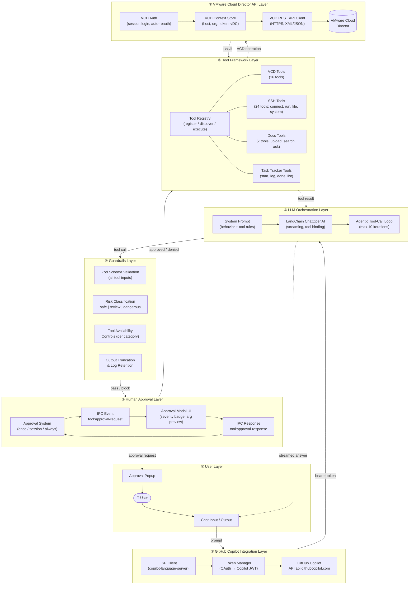
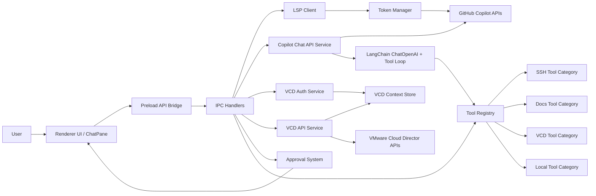
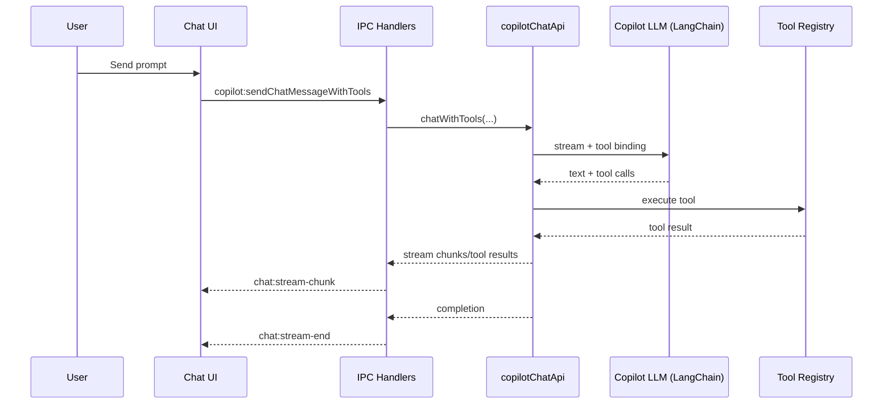
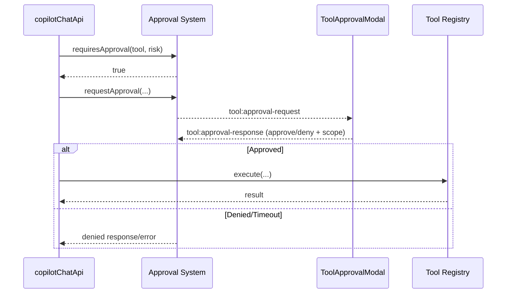
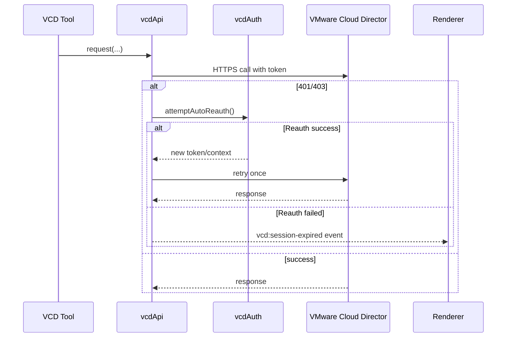

# Local Copilot – Architectural Design (LLM, Tools, VMware APIs, Guardrails, Approvals, Copilot Integration)

## 1. Scope and Intent

This design describes the **runtime architecture of Local Copilot’s AI and automation core**, with explicit focus on:

- LLM orchestration
- Tooling framework
- VMware Cloud Director (VCD) API integration
- Guardrails and risk controls
- Human approval popups
- GitHub Copilot integration

> Out of scope: Electron window/shell internals and desktop packaging concerns.

---

## 1.1 High-Level Layered Architecture

The diagram below shows the system as a set of **stacked layers**, each with a clear responsibility.  
Read top-to-bottom: user intent flows down; results and notifications flow back up.

### Layer Responsibilities at a Glance

| # | Layer | What it does |
|---|---|---|
| ① | **User** | Sends natural-language requests; sees streamed answers; makes approval decisions |
| ② | **Copilot Integration** | Authenticates with GitHub Copilot, manages token lifecycle |
| ③ | **LLM Orchestration** | Plans steps, selects tools, runs iterative tool-call loop |
| ④ | **Guardrails** | Validates inputs, classifies risk, controls which tools are active, caps output |
| ⑤ | **Human Approval** | Intercepts non-safe actions, raises UI prompt, blocks execution until user decides |
| ⑥ | **Tool Framework** | Executes the actual capabilities (VCD, SSH, Docs, Task tracking) |
| ⑦ | **VMware API** | Talks to VMware Cloud Director REST API; handles auth expiry and retry |

---

## 2. Architectural Overview

### Key Principle

The system is organized as a **tool-calling AI control plane**:
1. Copilot-backed LLM plans steps.
2. Tool framework executes constrained actions.
3. Guardrails enforce risk/approval boundaries.
4. VMware APIs provide infrastructure operations.

---

## 3. Runtime Components

## 3.1 Copilot Integration Layer

### Components
- **`lspClient.ts`**: Starts and communicates with `@github/copilot-language-server` over JSON-RPC.
- **`tokenManager.ts`**:
  - Captures token notifications from LSP.
  - Reads local Copilot OAuth tokens from disk (`apps.json`/`hosts.json`).
  - Exchanges OAuth token for Copilot API token.
  - Validates token shape and expiration.
- **`copilotChatApi.ts`**:
  - Builds request headers aligned with Copilot integration metadata.
  - Retrieves models (`/models`) and performs streaming chat via LangChain `ChatOpenAI` against `api.githubcopilot.com`.

### Role in Architecture
- Provides **identity, model access, and generation channel** for all conversational execution.
- Decouples token lifecycle from tool execution lifecycle.

---

## 3.2 LLM + Tool Orchestration Layer

### Components
- **`copilotChatApi.ts`**:
  - Defines structured system prompt and tool-usage behavior.
  - Binds tools (`bindTools`) and runs iterative tool-calling loop.
  - Streams text/tool-result chunks back to UI.
  - Supports cancellation with `AbortController`.
- **Tool groups integrated in loop**:
  - Built-in VCD tools (VM/snapshot/task workflows)
  - Task-tracker tools
  - Registry-backed docs and SSH tools

### Execution Model
- Iterative loop with capped iterations.
- For each turn:
  1. Stream assistant output.
  2. Collect structured tool calls.
  3. Execute tool calls.
  4. Feed tool outputs back as tool messages.
  5. Continue until no tool calls remain.

---

## 3.3 Tool Framework

### Core Contracts
- **`tools/types.ts`** defines:
  - `ToolCategory` (vcd/ssh/local/docs/etc.)
  - `ToolRiskLevel` (`safe`, `review`, `dangerous`)
  - Tool metadata, schema, execution context
  - Approval request/response structures

### Registry
- **`tools/registry.ts`**:
  - Singleton registry for registration/discovery/execution.
  - Exposes tool metadata and schemas for LangChain binding.
  - Initializes default categories (local, vcd, ssh, docs).

### Categories
- **VCD tools** (`tools/categories/vcd/index.ts`) for VM lifecycle and infrastructure actions.
- **SSH tools** (`tools/categories/ssh/*`) for remote command/session operations.
- **Docs tools** (`tools/categories/docs/index.ts`) for ingest/search/Q&A pipeline.
- **Local tools** for local environment actions.

---

## 3.4 Guardrails and Risk Controls

Guardrails are enforced through layered controls:

1. **Schema constraints**  
   Every tool is Zod-typed, reducing malformed calls.

2. **Risk classification**  
   Tools are tagged:
   - `safe`: read-only, auto-allow
   - `review`: mutable, approval expected
   - `dangerous`: destructive/high-impact, strict approval

3. **Approval gating**  
   In `buildRegistryTools`, non-safe tools are checked against approval policy before execution.

4. **Tool availability controls**  
   UI can disable tool groups; dynamic prompt addendum tells LLM what is unavailable.

5. **Output size control + auditability**  
   Large tool outputs are truncated for chat stream and full logs are retained via task tracker log storage.

6. **Orphan task cleanup**  
   Unfinished non-watcher tasks are auto-closed at chat completion.

---

## 3.5 Approval Popup Architecture (Human-in-the-Loop)

### Backend
- **`tools/approvalSystem.ts`**:
  - Decides if approval is required by risk + preferences.
  - Creates pending approval requests.
  - Sends request events to renderer (`tool:approval-request`).
  - Receives user decisions via IPC and resolves pending execution.
  - Supports approval scope: once/session/always.

### UI
- **`App.tsx`** listens for approval events and displays modal state.
- **`ToolApprovalModal.tsx`**:
  - Severity-aware UX for safe/review/dangerous.
  - Command/action preview.
  - Sensitive argument masking.
  - Explicit approval scope selection.

### IPC
- Request event: `tool:approval-request` (main → renderer)
- Response command: `tool:approval-response` (renderer → main)

---

## 3.6 VMware API Integration Layer

### Components
- **`vcdAuth.ts`**:
  - Authenticates to VCD session endpoint.
  - Extracts token and org context.
  - Persists encrypted session (Electron safe storage when available).
  - Populates shared VCD context.
- **`vcdApi.ts`**:
  - Executes REST calls to VMware Cloud Director.
  - Adds tenant/org headers from context.
  - Implements `httpsRequestWithAutoReauth` for 401/403 recovery.
  - On reauth failure, notifies UI to trigger relogin flow.
- **`vcdStore.ts`**:
  - Central source of current VCD runtime context.

### Operational Capabilities
- VM list/query/status
- power operations
- snapshot create/revert/list
- clone/copy operations
- resource resize
- task visibility
- IP allocation and deployment workflows

---

## 4. End-to-End Core Flows

## 4.1 Chat with Tool Execution Flow

## 4.2 Approval-Gated Tool Execution

## 4.3 VMware API Request with Auto-Reauth

---

## 5. Architectural Guardrail Matrix

| Concern | Mechanism | Primary Module |
|---|---|---|
| Token validity | LSP + disk token discovery + token exchange | `lspClient.ts`, `tokenManager.ts` |
| Unsafe tool usage | Risk-level classification and approval checks | `tools/types.ts`, `approvalSystem.ts`, `copilotChatApi.ts` |
| User control | Per-tool disablement and runtime availability prompt | `ChatPane.tsx`, `copilotChatApi.ts` |
| Destructive operations | Dangerous tools require explicit approval | Tool category modules + approval modal |
| Sensitive UI rendering | Sensitive arg masking in approval UI | `ToolApprovalModal.tsx` |
| Long outputs | Truncation + log retention | `copilotChatApi.ts`, `taskTracker.ts` |
| Expired VCD session | Auto-reauth + session-expired event | `vcdApi.ts`, `vcdAuth.ts`, `App.tsx` |

---

## 6. Integration Boundaries

## 6.1 Copilot Boundary
- External dependency for model serving and model list.
- Accessed through authenticated token flow and Copilot-specific headers.

## 6.2 VMware Boundary
- External infrastructure control plane.
- All VM lifecycle actions are mediated through `vcdApi.ts` abstractions.

## 6.3 User Approval Boundary
- Execution of review/dangerous actions crosses an explicit human decision boundary before invocation.

---

## 7. Non-Functional Architecture Characteristics

- **Security-oriented orchestration**: approvals, token validation, masked sensitive parameters.
- **Operational resilience**: retry and auto-reauth for VCD session expiry.
- **Observability**: API logging hooks across Copilot and VCD interactions.
- **Extensibility**: category-based tool registration and schema-driven contracts.
- **User governance**: configurable tool availability and approval scopes.

---

## 8. Recommended Presentation Narrative

For office presentation, describe architecture in this order:
1. Control-plane overview (LLM + tools + approvals).
2. Copilot integration lifecycle (LSP → token manager → model endpoint).
3. Tool registry and risk model.
4. Approval popup as the human-in-the-loop safety gate.
5. VMware execution path with auto-reauth.
6. Guardrail matrix and enterprise readiness.

