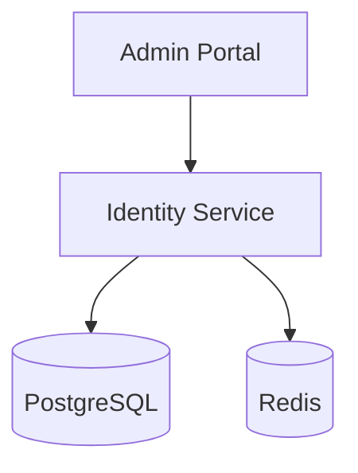
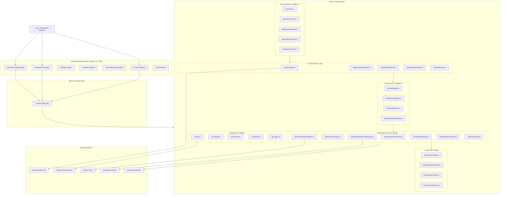
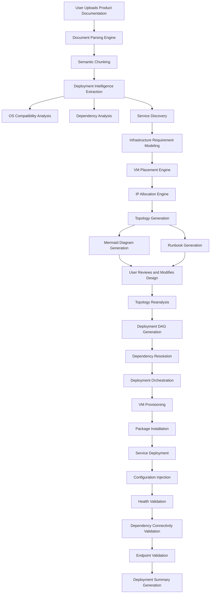
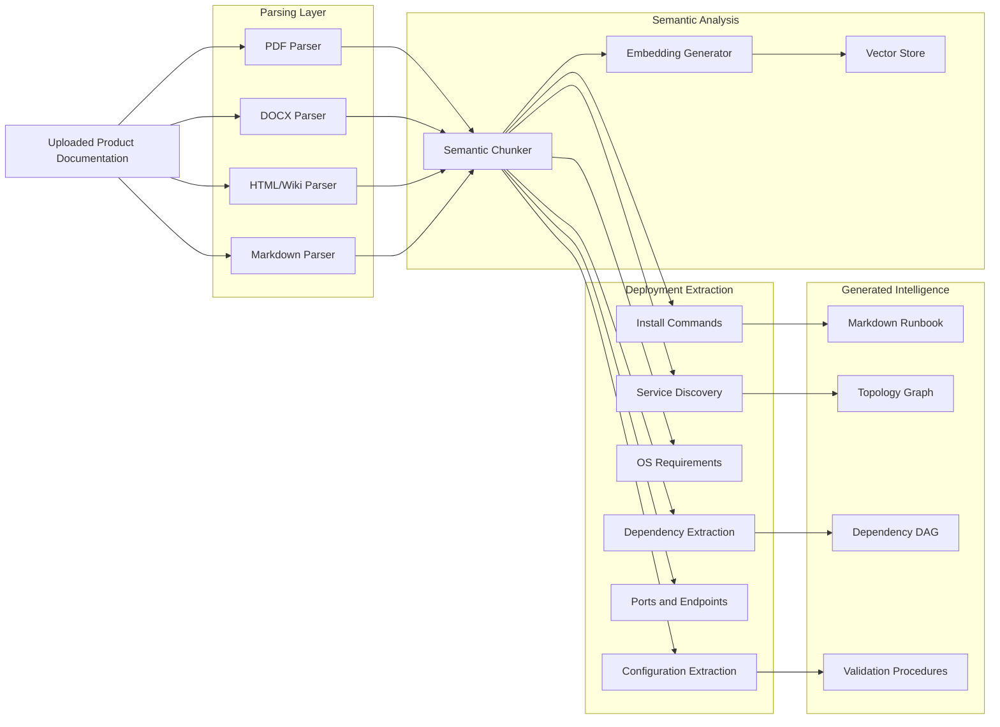
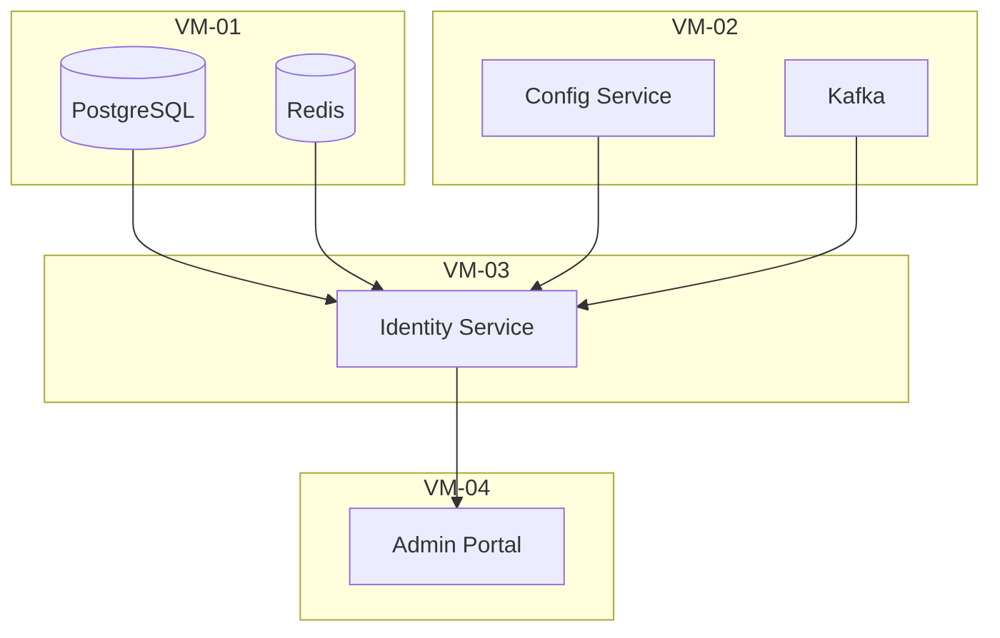
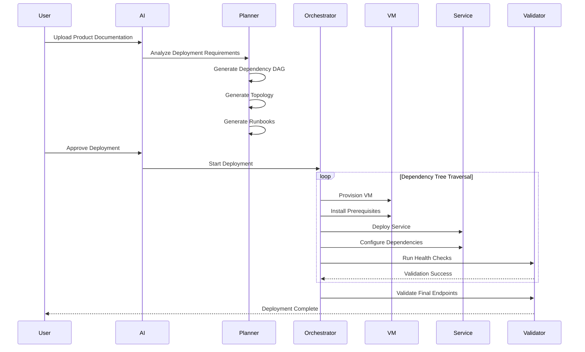
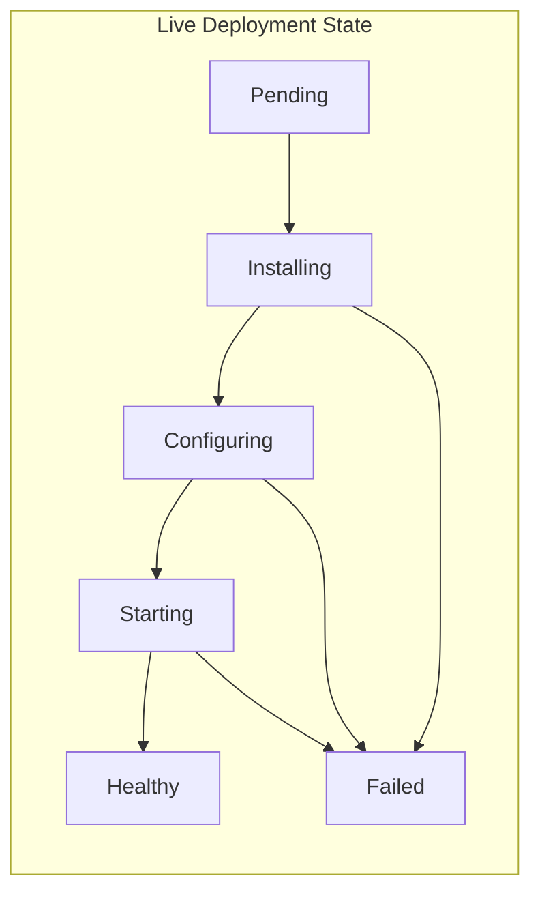
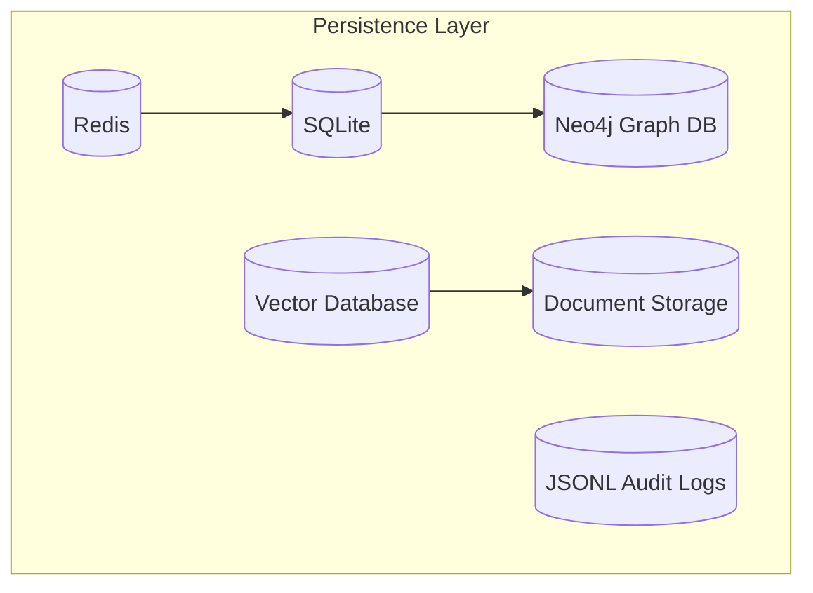
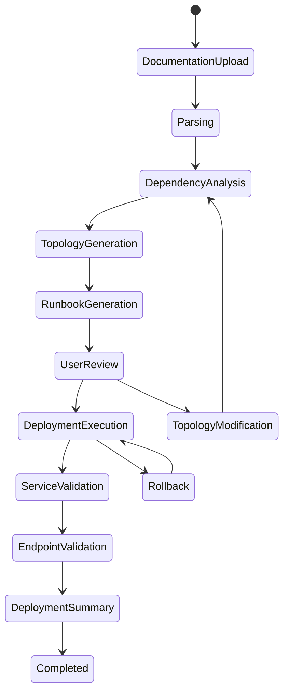

# VCD Agent — Enterprise Deployment Intelligence and Autonomous Orchestration Architecture

**Version:** 1.0
**Platform:** VCD Agent
**Application ID:** `com.local.vcdagent`
**Architecture Type:** AI-Driven Deployment Intelligence and Autonomous Infrastructure Orchestration Platform

---

# 1. Vision

VCD Agent evolves from a VMware Cloud Director management desktop application into a complete AI-driven deployment intelligence and autonomous orchestration platform.

The platform will:

* Ingest and analyze enterprise product documentation
* Understand infrastructure and deployment requirements
* Generate deployment topology designs automatically
* Build dependency-aware service maps
* Allocate infrastructure resources dynamically
* Generate executable deployment runbooks
* Orchestrate deployments across VMs and containers
* Continuously validate deployment health
* Visualize deployment state in real time
* Support iterative architecture redesign and redeployment

The platform becomes a fully autonomous deployment engineering assistant capable of converting product documentation into deployable infrastructure and operational environments.

---

# 2. Extended Platform Architecture

```text
┌────────────────────────────────────────────────────────────────────────────┐
│                         Electron Renderer Process                          │
│                                                                            │
│  React 19 + Vite + Monaco + Mermaid + xterm.js                             │
│                                                                            │
│ ┌────────────────────────────────────────────────────────────────────────┐ │
│ │                         User Interaction Layer                        │ │
│ │                                                                        │ │
│ │ ChatPane           DeploymentDesigner        ServiceTopologyViewer     │ │
│ │ VmInfrastructure   DependencyGraphViewer     RunbookExplorer           │ │
│ │ DeploymentStatus   LiveDeploymentMonitor     HealthValidationPanel     │ │
│ │ DocumentExplorer   ArchitectureEditor        DeploymentTimeline        │ │
│ └────────────────────────────────────────────────────────────────────────┘ │
│                                                                            │
│ window.copilot ◄──────── contextBridge / preload.ts ───────► IPC          │
└───────────────────────────────┬────────────────────────────────────────────┘
                                │
                                │ IPC
                                ▼
┌────────────────────────────────────────────────────────────────────────────┐
│                         Electron Main Process                              │
│                                                                            │
│ ┌────────────────────────────────────────────────────────────────────────┐ │
│ │                         AI Orchestration Layer                         │ │
│ │                                                                        │ │
│ │ copilotChatApi.ts                                                      │ │
│ │ langGraphOrchestrator.ts                                               │ │
│ │ deploymentPlanner.ts                                                   │ │
│ │ dependencyResolver.ts                                                  │ │
│ │ topologyGenerator.ts                                                   │ │
│ │ workflowEngine.ts                                                      │ │
│ └────────────────────────────────────────────────────────────────────────┘ │
│                                                                            │
│ ┌────────────────────────────────────────────────────────────────────────┐ │
│ │                       Documentation Intelligence                       │ │
│ │                                                                        │ │
│ │ docParser.ts                                                           │ │
│ │ semanticChunker.ts                                                     │ │
│ │ deploymentExtractor.ts                                                 │ │
│ │ osCompatibilityAnalyzer.ts                                             │ │
│ │ dependencyAnalyzer.ts                                                  │ │
│ │ serviceDiscoveryEngine.ts                                              │ │
│ │ runbookGenerator.ts                                                    │ │
│ │ markdownCompiler.ts                                                    │ │
│ └────────────────────────────────────────────────────────────────────────┘ │
│                                                                            │
│ ┌────────────────────────────────────────────────────────────────────────┐ │
│ │                      Infrastructure Intelligence                       │ │
│ │                                                                        │ │
│ │ ipPoolManager.ts                                                       │ │
│ │ vmPlacementEngine.ts                                                   │ │
│ │ resourceAllocator.ts                                                   │ │
│ │ environmentTopologyStore.ts                                            │ │
│ │ infrastructureGraphStore.ts                                            │ │
│ └────────────────────────────────────────────────────────────────────────┘ │
│                                                                            │
│ ┌────────────────────────────────────────────────────────────────────────┐ │
│ │                      Deployment Execution Engine                       │ │
│ │                                                                        │ │
│ │ deploymentOrchestrator.ts                                              │ │
│ │ deploymentExecutor.ts                                                  │ │
│ │ sshExecutionEngine.ts                                                  │ │
│ │ dockerDeploymentEngine.ts                                              │ │
│ │ kubernetesDeploymentEngine.ts                                          │ │
│ │ serviceBootstrapper.ts                                                 │ │
│ │ healthValidationEngine.ts                                              │ │
│ │ rollbackManager.ts                                                     │ │
│ └────────────────────────────────────────────────────────────────────────┘ │
│                                                                            │
│ ┌────────────────────────────────────────────────────────────────────────┐ │
│ │                         Visualization Engine                           │ │
│ │                                                                        │ │
│ │ mermaidGenerator.ts                                                    │ │
│ │ deploymentStateTracker.ts                                              │ │
│ │ liveTopologyUpdater.ts                                                 │ │
│ │ dependencyVisualizer.ts                                                │ │
│ │ runtimeFlowRenderer.ts                                                 │ │
│ └────────────────────────────────────────────────────────────────────────┘ │
│                                                                            │
│ ┌────────────────────────────────────────────────────────────────────────┐ │
│ │                           Existing Core Layer                          │ │
│ │                                                                        │ │
│ │ VCD API Layer                                                          │ │
│ │ Tool Registry                                                          │ │
│ │ Task Tracker                                                           │ │
│ │ SSH Management                                                         │ │
│ │ VM Watcher                                                             │ │
│ │ API Logger                                                             │ │
│ │ Auto Updater                                                           │ │
│ └────────────────────────────────────────────────────────────────────────┘ │
└───────────────────────────────┬────────────────────────────────────────────┘
                                │
                                │
        ┌───────────────────────┼────────────────────────┐
        │                       │                        │
        ▼                       ▼                        ▼

┌─────────────────┐   ┌────────────────────┐   ┌────────────────────┐
│ VMware Cloud    │   │ GitHub Copilot LSP │   │ External Systems    │
│ Director API    │   │ LangChain / LLM    │   │ Docker / K8s / DBs  │
└─────────────────┘   └────────────────────┘   └────────────────────┘
```

---

# 3. Core Architectural Domains

---

# 3.1 Documentation Intelligence Layer

## Objective

Transform unstructured enterprise deployment documentation into structured deployment intelligence.

---

## Components

### `docParser.ts`

Responsible for:

* PDF parsing
* DOCX parsing
* HTML/Wiki parsing
* Markdown parsing
* ISO deployment document extraction
* Command extraction
* Configuration extraction

Supported parsers:

* `pdf-parse`
* `mammoth`
* `cheerio`
* `markdown-it`

---

### `semanticChunker.ts`

Breaks documents into semantically meaningful chunks:

* Installation sections
* Dependency sections
* Deployment modes
* Service definitions
* Configuration blocks
* Validation steps

Uses:

* Embedding models
* Semantic similarity grouping
* Context-aware chunking

---

### `deploymentExtractor.ts`

Extracts deployment intelligence:

* Supported OS versions
* Required packages
* Required runtimes
* Deployment commands
* Startup scripts
* Service registration logic
* Ports
* Endpoints
* Cluster requirements

---

### `dependencyAnalyzer.ts`

Builds dependency relationships:

```text
Identity Service
    ├── PostgreSQL
    ├── Redis
    ├── Kafka
    └── Config Service
```

Outputs:

* Directed dependency graph
* Runtime dependency chains
* Startup sequencing rules

---

### `runbookGenerator.ts`

Produces structured deployment markdown:

* VM-by-VM deployment steps
* Service-by-service runbooks
* Dependency-aware startup sequences
* Health validation procedures

---

# 3.2 Infrastructure Intelligence Layer

## Objective

Convert deployment requirements into deployable infrastructure topology.

---

## Components

### `vmPlacementEngine.ts`

Determines:

* Number of VMs required
* VM roles
* Resource allocation
* Service placement strategy

Supports:

* Single-node deployment
* Distributed deployment
* HA deployments
* Hybrid deployments

---

### `ipPoolManager.ts`

Manages:

* Dynamic IP allocation
* Subnet awareness
* Reserved IP tracking
* Collision prevention
* Service-to-IP mappings

---

### `infrastructureGraphStore.ts`

Maintains complete infrastructure graph:

```text
VM-01
 ├── PostgreSQL
 ├── Redis
 └── Config Service

VM-02
 ├── API Gateway
 └── Identity Service
```

---

# 3.3 Topology and Design Generation

## Objective

Generate editable deployment architecture automatically.

---

## Components

### `topologyGenerator.ts`

Builds logical deployment architecture from:

* Documentation analysis
* Dependency graph
* Infrastructure requirements

---

### `mermaidGenerator.ts`

Generates:

* Service topology diagrams
* VM topology diagrams
* Network communication flows
* Dependency flow diagrams

Example:



---

### `dependencyVisualizer.ts`

Renders:

* Runtime dependency chains
* Startup ordering
* Service dependency impact analysis

---

# 3.4 AI Deployment Planning Engine

## Objective

Build autonomous deployment execution plans.

---

## Components

### `deploymentPlanner.ts`

Generates deployment strategy:

* Service sequencing
* Infrastructure preparation order
* Parallelization opportunities
* Rollback checkpoints

---

### `dependencyResolver.ts`

Computes:

* Dependency DAG traversal
* Leaf-first deployments
* Top-down deployments
* Circular dependency handling

---

### `langGraphOrchestrator.ts`

Controls agent workflow execution using LangGraph:

```text
Documentation Analysis
        ↓
Topology Generation
        ↓
Dependency Resolution
        ↓
Runbook Generation
        ↓
Infrastructure Provisioning
        ↓
Deployment Execution
        ↓
Health Validation
        ↓
Finalization
```

---

# 3.5 Deployment Execution Engine

## Objective

Autonomously deploy products across infrastructure.

---

## Components

### `deploymentOrchestrator.ts`

Main execution coordinator.

Responsibilities:

* Execute deployment DAG
* Coordinate service deployment
* Trigger validations
* Manage retries

---

### `sshExecutionEngine.ts`

Executes:

* Linux commands
* Sudo operations
* Binary installation
* Package installation
* Service startup

---

### `dockerDeploymentEngine.ts`

Handles:

* Docker image pulls
* Container deployments
* Compose orchestration

---

### `kubernetesDeploymentEngine.ts`

Handles:

* Helm deployments
* Namespace creation
* Service deployment
* StatefulSet management

---

### `serviceBootstrapper.ts`

Injects:

* Service configuration
* Dependency endpoints
* Runtime environment variables
* Secrets/configuration

---

### `healthValidationEngine.ts`

Performs:

* Port validation
* API health checks
* Process validation
* Database connectivity validation
* Cross-service communication validation

---

### `rollbackManager.ts`

Supports:

* Transactional rollback
* Partial rollback
* Service restoration
* Deployment checkpoint recovery

---

# 3.6 Live Deployment Visualization

## Objective

Provide real-time deployment visibility.

---

## Components

### `deploymentStateTracker.ts`

Tracks:

* Deployment progress
* Service state
* Retry state
* Failure state
* Validation state

---

### `liveTopologyUpdater.ts`

Updates Mermaid topology dynamically:

* Deploying
* Running
* Failed
* Waiting
* Healthy

---

### `runtimeFlowRenderer.ts`

Shows:

* Active network communication
* Established service connectivity
* Data flow paths
* Dependency satisfaction

---

# 4. Deployment Lifecycle

---

# Phase 1 — Documentation Upload

User uploads:

* Product installation documents
* Deployment guides
* Architecture manuals

---

# Phase 2 — AI Analysis

Platform extracts:

* Services
* Dependencies
* OS requirements
* Deployment modes
* Runtime requirements

---

# Phase 3 — Architecture Generation

System generates:

* VM topology
* Service placement
* Dependency graph
* Mermaid diagrams
* Deployment runbooks

---

# Phase 4 — User Review and Modification

User can:

* Modify topology
* Move services
* Change deployment modes
* Update infrastructure mapping

System recalculates:

* Dependencies
* Prerequisites
* Deployment order

---

# Phase 5 — Deployment Execution

Platform:

* Traverses dependency DAG
* Deploys infrastructure
* Executes runbooks
* Starts services
* Validates health

---

# Phase 6 — Live Monitoring

Platform updates:

* Deployment states
* Connectivity flows
* Health indicators
* Failure conditions

---

# Phase 7 — Final Validation

Platform validates:

* Endpoints
* Open ports
* APIs
* Service connectivity

---

# Phase 8 — Deployment Summary

Generates:

* Final deployment report
* Service inventory
* Endpoint inventory
* Deployment audit log
* Infrastructure summary

---

# 5. Recommended Persistence Architecture

| Store        | Purpose                  |
| ------------ | ------------------------ |
| SQLite       | Local metadata           |
| Neo4j        | Dependency graph storage |
| Vector DB    | RAG embeddings           |
| JSONL        | Deployment audit logs    |
| Redis        | Runtime deployment state |
| File Storage | Uploaded documents       |

---

# 6. Recommended Future Enhancements

* Terraform generation
* Ansible playbook export
* Kubernetes Helm generation
* OpenShift deployment support
* Cloud deployment abstraction
* Multi-environment promotion pipelines
* AI-assisted failure remediation
* Self-healing deployments
* Predictive dependency analysis
* AI-generated rollback planning

---

# 7. Final Platform Positioning

VCD Agent becomes:

> An AI-native enterprise deployment intelligence, infrastructure topology generation, and autonomous orchestration platform capable of transforming product documentation into fully deployed and validated enterprise environments.


# VCD Agent — Enterprise Deployment Intelligence and Autonomous Orchestration Architecture

**Version:** 1.0
**Platform:** VCD Agent
**Application ID:** `com.local.vcdagent`
**Architecture Type:** AI-Driven Deployment Intelligence and Autonomous Infrastructure Orchestration Platform

---

# 1. Vision

VCD Agent evolves from a VMware Cloud Director management desktop application into a complete AI-driven deployment intelligence and autonomous orchestration platform.

The platform will:

* Ingest and analyze enterprise product documentation
* Understand infrastructure and deployment requirements
* Generate deployment topology designs automatically
* Build dependency-aware service maps
* Allocate infrastructure resources dynamically
* Generate executable deployment runbooks
* Orchestrate deployments across VMs and containers
* Continuously validate deployment health
* Visualize deployment state in real time
* Support iterative architecture redesign and redeployment

The platform becomes a fully autonomous deployment engineering assistant capable of converting product documentation into deployable infrastructure and operational environments.

---

# 2. High-Level Enterprise Architecture



---

# 3. End-to-End Deployment Intelligence Flow



---

# 4. Documentation Intelligence Architecture



---

# 5. Dependency-Aware Deployment Architecture



---

# 6. Deployment Orchestration Flow



---

# 7. Live Deployment State Visualization



---

# 8. Infrastructure Persistence Architecture



---

# 9. Autonomous Deployment Lifecycle



---

# 10. Final Platform Positioning

VCD Agent becomes:

> An AI-native enterprise deployment intelligence, topology generation, dependency orchestration, and autonomous deployment platform capable of transforming unstructured product documentation into fully deployed, validated, monitored, and operational enterprise environments.
