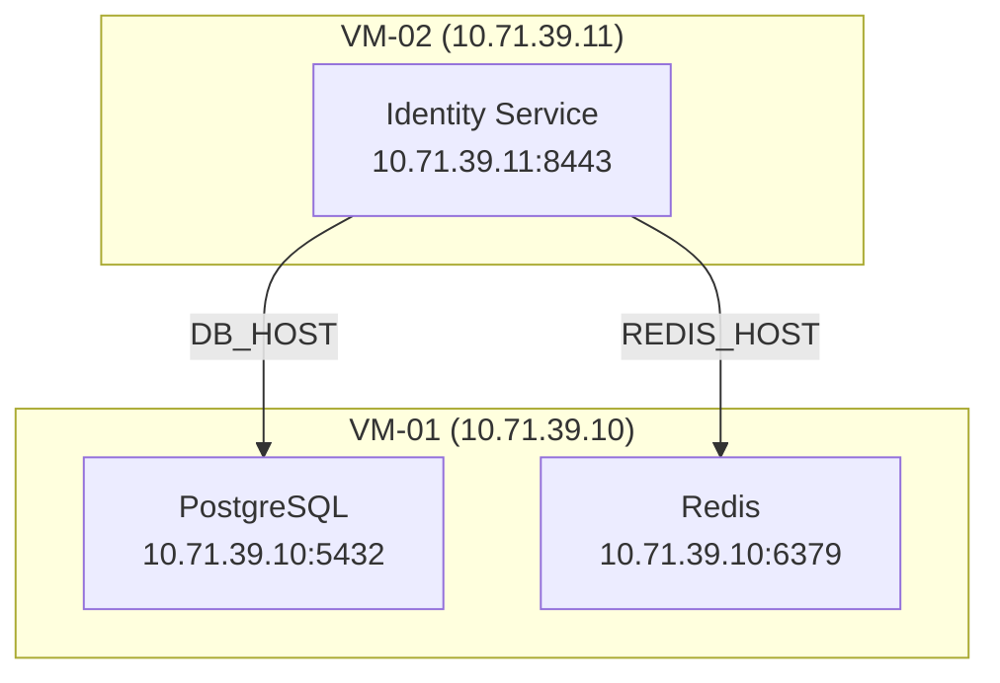

# VCD Agent — Backend Implementation Plan
## Deployment Intelligence & Autonomous Orchestration

**Version:** 1.0  
**Date:** May 2026  
**Scope:** Backend only (`src/main/`). Renderer and preload changes are limited to IPC wiring. No new React components.

---

## 1. Objective

Build a backend pipeline that:

1. Parses uploaded product documentation
2. Extracts structured deployment intelligence (services, OS requirements, install steps, dependencies, ports)
3. Generates a Mermaid topology diagram and a per-service markdown runbook
4. Allocates IPs and computes VM topology
5. Executes the deployment autonomously in dependency order
6. Validates health after each service and updates the diagram live
7. Produces a final deployment summary report

---

## 2. Existing Assets — No Re-implementation

| Module | What it provides |
|---|---|
| `docs/parser.ts` | PDF/DOCX/MD parsing, section splitting |
| `docs/pipeline.ts` | LLM calls to `gpt-4o` via Copilot API, proven JSON-response pattern |
| `docs/storage.ts` | SQLite `better-sqlite3`, `documents` + `chunks` tables, full-text search |
| `ssh/command.ts` | `ssh:runCommand`, `ssh:runScript`, `ssh:startBackground` (24 tools) |
| `ssh/session.ts` | SSH connect/disconnect with 3-retry, 60 s timeout, session ID map |
| `ssh/system.ts` | `ssh:checkService`, `ssh:manageService`, `ssh:systemInfo` |
| `taskTracker.ts` | Task/step CRUD, LRU 5 MB log store, IPC push on state change |
| `vcdApi.ts` | `createVmFromTemplate`, `allocateFreeIp`, `listTemplates` |
| `tools/registry.ts` | `register()` + approval-gated `execute()` |
| `copilotChatApi.ts` | LangChain tool loop, streaming, `TOOL_SYSTEM_PROMPT` |

---

## 3. Architecture Overview

```
User uploads product docs (PDF / DOCX / MD)
          │
          ▼
Phase 1 — Document Intelligence Extraction
  deploymentExtractor.ts  ──►  dependencyAnalyzer.ts
  (multi-call LLM strategy)       (DAG + topo sort)
          │
          ▼
Phase 2 — Design Generation & Storage
  vmPlacementEngine.ts  ──►  mermaidGenerator.ts  ──►  runbookGenerator.ts
  deploymentStore.ts (SQLite)
          │
          ▼
Phase 3 — Infrastructure Planning
  ipPoolManager.ts   ──►  vmPlacementEngine.buildDeploymentDesign()
  (parallel IP allocation)
          │
          ▼
Phase 4 — Deployment Execution
  deploymentOrchestrator.ts
    ├── Provision VMs in parallel (vcdApi)
    ├── SSH connect all VMs
    ├── Walk dependency DAG leaf-first
    │     ├── Run install steps (ssh:runCommand / ssh:runScript)
    │     ├── Inject dependency IPs as env vars
    │     ├── healthValidationEngine.validateService()  ← retry × 3
    │     └── Update Mermaid diagram live  ──► IPC push
    └── Final endpoint validation  ──► deployment summary
          │
          ▼
Phase 5 — Tool & IPC Integration
  tools/categories/deployment/index.ts  (10 tools)
  ipcHandlers.ts additions
  copilotChatApi.ts system prompt extension
```

---

## 4. Key Design Decisions

### 4.1 LLM Extraction Strategy for Complex Documents

**Problem:** Single-pass extraction of a large document (e.g. 80-page ILM guide) will exceed the context window and produce poor-quality structured JSON.

**Decision:** The extractor uses a **chunked multi-call strategy** as the default, with single-pass available for small documents.

```
strategy: 'single-pass'  ← docs < 20 chunks
strategy: 'chunked'      ← docs ≥ 20 chunks (default for real product docs)
```

Chunked execution order:
1. **Pass 1 — Topology pass:** Feed the full chunk set (truncated to 12 000 tokens) and ask only for: `products[]`, `deploymentModes[]`, top-level `services[]` (name + role only). This anchors the schema.
2. **Pass 2 — Per-service detail pass:** For each service ID returned in Pass 1, retrieve the 4–6 most relevant chunks from `docs/storage.ts:search(serviceId)` and run a focused extraction prompt asking for `installSteps`, `ports`, `healthCheck`, `requiresConfigFrom`, `supportedOS` for that service only.
3. **Pass 3 — Cross-check pass:** Single call presenting the full services list asking the model to verify `requiresConfigFrom` relationships are complete and symmetric.

This approach:
- Stays well within context limits regardless of document size
- Produces sharper per-service detail (focused context)
- Detects missed dependencies via the cross-check pass
- Adds ~2–3 extra LLM round trips but dramatically improves extraction fidelity

The extractor exposes a `strategy` parameter: `extractFromDocument(documentId, { strategy?: 'auto' | 'single-pass' | 'chunked' })`. Default is `'auto'` (chooses based on chunk count).

---

### 4.2 VM Provisioning Parallelism

**Problem:** Deploying VMs sequentially before executing service installs wastes significant wall-clock time (each `createVmFromTemplate` can take 2–5 minutes).

**Decision:** The orchestrator separates execution into two distinct phases:

**Phase A — Provision (parallel):**
- Identify all VMs required by the design
- Kick off all `createVmFromTemplate()` calls concurrently via `Promise.all()`
- Wait for all VMs to reach `POWERED_ON` state (polled via `vmWatcher` or direct `checkVmStatus`)
- SSH connect all VMs concurrently once all are up
- Store all session IDs in `runState.vmSessions`

**Phase B — Deploy services (dependency-ordered, serial per chain, parallel across independent branches):**
- Walk `dependencyGraph.deploymentOrder` (topological leaf-first)
- Services in the same topological level (no dependency between them) are deployed in parallel using `Promise.all()`
- Services with a direct dependency are deployed strictly in sequence
- State updates and Mermaid regeneration happen per-service after health check passes

This means: for a 4-VM deployment where VM1+VM2 are leaves and VM3+VM4 depend on them, VM1 and VM2 are provisioned in parallel, their services are deployed in parallel, and only then does VM3/VM4 deployment begin.

Topology-level parallelism is tracked in `runState.currentLevel: number` to aid debugging and status reporting.

---

## 5. Data Model

File: `src/main/deployment/types.ts`

```typescript
// ── Extraction ────────────────────────────────────────────────────────────

export interface OSRequirement {
  type: string;               // 'sles' | 'rhel' | 'ubuntu' | ...
  minVersion?: string;        // '15.4'
  maxVersion?: string;
}

export interface PortSpec {
  port: number;
  protocol: 'tcp' | 'udp';
  description: string;
  isPublic: boolean;          // externally accessible endpoint
}

export interface ConfigKey {
  key: string;                // env var name this service exports (e.g. 'DB_HOST')
  description: string;
}

export interface InstallStep {
  osType?: string;            // undefined = applies to all OS types
  stepNumber: number;
  description: string;
  command?: string;
  isPrerequisite: boolean;
  expectedExitCode: number;
  timeoutSeconds?: number;
}

export interface HealthCheckSpec {
  type: 'port' | 'http' | 'process' | 'systemctl';
  target: string;             // port number, URL path, process name, or systemd unit
  expectedStatus?: string;    // '200', 'active', etc.
  timeoutSeconds: number;
  retryIntervalSeconds: number;
}

export interface ResourceSpec {
  minCpuCores?: number;
  minMemoryMb?: number;
  minDiskGb?: number;
}

export interface ServiceSpec {
  id: string;                 // stable slug, e.g. 'identity-service'
  name: string;
  role: 'primary' | 'dependency' | 'optional';
  deployOn: 'vm' | 'docker' | 'k8s';
  ports: PortSpec[];
  installSteps: InstallStep[];
  healthCheck: HealthCheckSpec;
  configKeys: ConfigKey[];    // what this service exposes to dependents
  requiresConfigFrom: string[]; // service IDs whose IPs/ports this service needs at startup
  resourceRequirements?: ResourceSpec;
}

export interface DeploymentMode {
  name: string;               // 'single-node' | 'distributed' | 'ha'
  vmCount: number;
  description: string;
  serviceAssignments: Record<string, string[]>; // vmRole → serviceId[]
}

export interface ProductSpec {
  name: string;
  version?: string;
  supportedOS: OSRequirement[];
  services: ServiceSpec[];
}

export interface DeploymentIntelligence {
  documentId: string;
  products: ProductSpec[];
  deploymentModes: DeploymentMode[];
  extractedAt: number;
  extractionStrategy: 'single-pass' | 'chunked';
  extractionWarnings: string[]; // cycle detections, ambiguous sections, etc.
}

// ── Design ────────────────────────────────────────────────────────────────

export interface VmPlan {
  id: string;                 // 'vm-01', 'vm-02'
  role: string;               // maps to DeploymentMode.serviceAssignments key
  services: ServiceSpec[];
  osRequirement: OSRequirement;
  resourceHints: ResourceSpec;
  vmName?: string;            // assigned during IP/infra planning
  ip?: string;                // assigned during IP planning
}

export interface DependencyEdge {
  from: string;               // serviceId
  to: string;                 // serviceId (from depends on to)
  configKeys: string[];       // which config keys flow across this edge
}

export interface DependencyGraph {
  nodes: string[];            // serviceId[]
  edges: DependencyEdge[];
  deploymentOrder: string[];  // topological leaf-first (deploy bottom-up)
  teardownOrder: string[];    // reverse (teardown top-down)
  levels: string[][];         // services at same topological level (parallel candidates)
}

export interface DeploymentDesign {
  id: string;
  documentId: string;
  intelligence: DeploymentIntelligence;
  vms: VmPlan[];
  ipAssignments: Record<string, string>; // serviceId → ip
  dependencyGraph: DependencyGraph;
  mermaid?: string;
  runbook?: string;
  status: 'draft' | 'approved' | 'deploying' | 'deployed' | 'failed';
  createdAt: number;
  updatedAt: number;
}

// ── Run State ─────────────────────────────────────────────────────────────

export type ServiceDeployStatus =
  | 'pending' | 'installing' | 'configuring' | 'starting'
  | 'healthy' | 'failed' | 'skipped';

export interface ServiceState {
  serviceId: string;
  status: ServiceDeployStatus;
  vmId: string;
  attempts: number;
  lastError?: string;
  deployedAt?: number;
  healthCheckedAt?: number;
}

export type OrchestratorPhase =
  | 'idle' | 'snapshotting' | 'provisioning' | 'connecting'
  | 'deploying' | 'validating' | 'complete' | 'failed' | 'rolledback';

export interface DeploymentRunState {
  runId: string;
  designId: string;
  taskId: string;             // links to taskTracker
  serviceStates: Record<string, ServiceState>;
  vmSessions: Record<string, string>; // vmId → sshSessionId
  snapshotNames: Record<string, string>; // vmName → snapshotName
  phase: OrchestratorPhase;
  currentLevel: number;       // topological level being deployed (for status reporting)
  currentMermaid: string;     // regenerated on each state transition
  startedAt: number;
  completedAt?: number;
  summaryReport?: string;     // final markdown summary
}

// ── Validation ────────────────────────────────────────────────────────────

export interface ValidationResult {
  serviceId: string;
  passed: boolean;
  detail: string;
  durationMs: number;
}
```

---

## 6. Phase 1 — Document Intelligence Extraction

### Files

- **New:** `src/main/deployment/types.ts`
- **New:** `src/main/deployment/deploymentExtractor.ts`
- **New:** `src/main/deployment/dependencyAnalyzer.ts`

### `deploymentExtractor.ts`

```
export interface ExtractionOptions {
  strategy?: 'auto' | 'single-pass' | 'chunked';  // default: 'auto'
}

export async function extractFromDocument(
  documentId: string,
  options?: ExtractionOptions
): Promise<DeploymentIntelligence>
```

**`auto` strategy selection:**
- Fetch `getChunks(documentId)` count from `docs/storage.ts`
- If chunk count < 20 → `single-pass`
- If chunk count ≥ 20 → `chunked`

**`single-pass` execution:**
- Load all chunks (concatenated, truncated to 14 000 tokens)
- Single LLM call with full extraction prompt → parse JSON → validate with Zod

**`chunked` execution (3 passes):**

*Pass 1 — Topology (full-doc summary):*
```
Prompt: "Given the following product documentation, extract ONLY:
- Product name and version
- List of deployment modes (name, vmCount, description)
- List of services (id/slug, name, role: primary|dependency|optional)
Do not include install steps or dependencies yet.
Respond with JSON matching the ProductSpec schema."
```
Input: all chunks concatenated, hard-truncated to 12 000 tokens

*Pass 2 — Per-service detail (focused per-service context):*
```
Prompt: "Given documentation excerpts for the '<service-name>' service, extract:
- ports[], installSteps[], healthCheck, supportedOS[]
- requiresConfigFrom[] (service IDs this service needs IPs/ports from at startup)
- configKeys[] (env vars this service exposes)
Respond with JSON matching the ServiceSpec schema."
```
Input: top-6 chunks from `docs/storage.ts:search(serviceId + ' install')` for that service  
Execution: all services run in parallel `Promise.all()`

*Pass 3 — Dependency cross-check:*
```
Prompt: "Given this services list with their requiresConfigFrom fields, identify any
missing or asymmetric dependency relationships. Return an updated edges list."
```
Input: services list from Pass 1 + Pass 2 results (compact JSON, ~3 000 tokens)

**Error handling:**
- Zod validation failures: retry pass with stricter prompt ("respond ONLY with valid JSON, no prose")
- Max 2 retries per pass; on final failure record in `extractionWarnings[]` and continue with partial data

### `dependencyAnalyzer.ts`

```
export function buildDependencyGraph(services: ServiceSpec[]): DependencyGraph
```

**Algorithm:**
1. Build adjacency map from `service.requiresConfigFrom`
2. DFS cycle detection — on cycle found: record warning, remove the longest edge that creates the cycle
3. Kahn's algorithm for topological sort → produces `deploymentOrder` (leaf-first) and `teardownOrder`
4. Level assignment: BFS from all leaf nodes assigning each node a level number. Nodes at the same level have no inter-dependency and can be deployed in parallel → stored as `levels: string[][]`

---

## 7. Phase 2 — Design Generation & Persistence

### Files

- **Modified:** `src/main/tools/categories/docs/storage.ts` — extend `initDatabase()`
- **New:** `src/main/deployment/deploymentStore.ts`
- **New:** `src/main/deployment/mermaidGenerator.ts`
- **New:** `src/main/deployment/runbookGenerator.ts`

### Schema additions to `storage.ts`

Added inside the existing `initDatabase()` function after the current table definitions:

```sql
CREATE TABLE IF NOT EXISTS deployment_designs (
  id           TEXT PRIMARY KEY,
  document_id  TEXT NOT NULL,
  design_json  TEXT NOT NULL,
  mermaid      TEXT,
  runbook      TEXT,
  status       TEXT DEFAULT 'draft',
  created_at   INTEGER,
  updated_at   INTEGER
);

CREATE TABLE IF NOT EXISTS deployment_runs (
  id           TEXT PRIMARY KEY,
  design_id    TEXT NOT NULL,
  task_id      TEXT,
  state_json   TEXT NOT NULL,
  started_at   INTEGER,
  completed_at INTEGER,
  FOREIGN KEY (design_id) REFERENCES deployment_designs(id)
);
```

### `deploymentStore.ts`

Reuses the `db` singleton exported from `docs/storage.ts` — no second database connection.

```typescript
saveDesign(design: Omit<DeploymentDesign, 'id'>): string
updateDesign(id: string, partial: Partial<DeploymentDesign>): void
getDesign(id: string): DeploymentDesign
listDesigns(): Array<{ id, documentId, status, createdAt, updatedAt }>
deleteDesign(id: string): void

saveRun(run: Omit<DeploymentRunState, 'runId'>): string
updateRun(id: string, partial: Partial<DeploymentRunState>): void
getRun(id: string): DeploymentRunState
getRunsForDesign(designId: string): DeploymentRunState[]
```

### `mermaidGenerator.ts`

```
generateTopologyDiagram(design: DeploymentDesign): string
```

Output structure:


```
generateStateDiagram(design: DeploymentDesign, runState: DeploymentRunState): string
```

Same structure plus `classDef` blocks and `:::className` suffixes on each node:

```
classDef pending   fill:#888,color:#fff
classDef deploying fill:#f90,color:#fff
classDef healthy   fill:#2d2,color:#fff
classDef failed    fill:#d22,color:#fff

svc_postgres:::healthy
svc_identity:::deploying
```

Called by the orchestrator after every state transition. Result stored in `runState.currentMermaid` and pushed via IPC.

### `runbookGenerator.ts`

```
generateFullRunbook(design: DeploymentDesign): string
generateServiceRunbook(serviceId: string, design: DeploymentDesign): string
```

Full runbook structure:
```markdown
# <Product> Deployment Runbook
## Environment Summary
| Service | VM | IP | Ports |
|---|---|---|---|
...

## Deployment Order
1. PostgreSQL (VM-01)
2. Redis (VM-01)
3. Identity Service (VM-02) — depends on PostgreSQL, Redis

## VM-01 Runbook
### Prerequisites
...commands...

### Service: PostgreSQL
#### Install Steps
1. ...
#### Configuration
(no dependencies)
#### Health Check
nc -z localhost 5432

---

## VM-02 Runbook
### Service: Identity Service
#### Install Steps
1. ...
#### Dependency Injection
```bash
export DB_HOST=10.71.39.10
export DB_PORT=5432
export REDIS_HOST=10.71.39.10
export REDIS_PORT=6379
```
#### Health Check
curl -s -o /dev/null -w "%{http_code}" https://localhost:8443/health
```

---

## 8. Phase 3 — Infrastructure Planning

### Files

- **New:** `src/main/deployment/ipPoolManager.ts`
- **New:** `src/main/deployment/vmPlacementEngine.ts`

### `ipPoolManager.ts`

```typescript
async function allocateIpsForDesign(
  design: DeploymentDesign
): Promise<Record<string, string>>  // serviceId → ip
```

**Implementation:**
- For each service with `deployOn: 'vm'` in `design.vms`: call `vcdApi.allocateFreeIp()` concurrently via `Promise.all()` (one per VM, not per service — VMs get one IP each)
- Build `ipAssignments: Record<serviceId, ip>` — all services on the same VM share that VM's IP but use distinct ports
- On any allocation failure: record partial allocations in `deploymentStore`, emit warning, throw `IpAllocationError`
- `recordIpRelease(designId, vmId)` — store-only tracking (VCD has no explicit IP release API)

### `vmPlacementEngine.ts`

```typescript
function planVmTopology(
  intel: DeploymentIntelligence,
  modeName: string
): VmPlan[]

function buildDeploymentDesign(
  intel: DeploymentIntelligence,
  modeName: string,
  ipAssignments: Record<string, string>
): DeploymentDesign
```

`planVmTopology`:
- Selects `DeploymentMode` by `modeName`
- Maps `serviceAssignments` entries to `VmPlan` objects with OS requirements derived from the union of constituent services' `supportedOS`
- OS conflict detection: if two services on the same VM have non-overlapping `supportedOS`, emit a `ConflictError` with a descriptive message

`buildDeploymentDesign`:
- Calls `planVmTopology()` and `buildDependencyGraph()` (from `dependencyAnalyzer`)
- Attaches `ipAssignments`
- Generates initial Mermaid and runbook
- Returns the fully composed `DeploymentDesign` ready for `deploymentStore.saveDesign()`

---

## 9. Phase 4 — Deployment Orchestration

### Files

- **New:** `src/main/deployment/healthValidationEngine.ts`
- **New:** `src/main/deployment/rollbackManager.ts`
- **New:** `src/main/deployment/deploymentOrchestrator.ts`

### `healthValidationEngine.ts`

All checks execute via registered tools through `toolRegistry.execute()` using the VM's active SSH session ID:

| Method | SSH command | Maps to `HealthCheckSpec.type` |
|---|---|---|
| `checkPortOpen(sessionId, host, port, t)` | `nc -z -w<t> <host> <port>` | `'port'` |
| `checkHttpEndpoint(sessionId, url, status)` | `curl -s -o /dev/null -w "%{http_code}" <url>` | `'http'` |
| `checkProcessRunning(sessionId, name)` | `pgrep -x <name>` | `'process'` |
| `checkSystemdService(sessionId, unit)` | delegates to `ssh:checkService` | `'systemctl'` |

```typescript
async function validateService(
  sessionId: string,
  spec: ServiceSpec,
  design: DeploymentDesign
): Promise<ValidationResult>

async function validateAllServices(
  sessionId: string,
  vmPlan: VmPlan,
  design: DeploymentDesign
): Promise<ValidationResult[]>
```

Retry policy inside `validateService`: up to 3 attempts with 30 s sleep between attempts. On all 3 failures: return `{ passed: false }`.

### `rollbackManager.ts`

```typescript
async function snapshotBeforeDeployment(
  design: DeploymentDesign
): Promise<Record<string, string>>  // vmName → snapshotName

async function rollbackVm(vmName: string, snapshotName: string): Promise<void>

async function rollbackDeployment(runId: string): Promise<void>
```

`snapshotBeforeDeployment` runs all `vcdApi.createSnapshot()` calls concurrently. Snapshot name format: `pre-deploy-<designId>-<timestamp>`. Names stored in `runState.snapshotNames`.

`rollbackDeployment` loads the run from store, iterates `design.dependencyGraph.teardownOrder`, calls `rollbackVm()` for each unique VM name (serial, order matters for teardown).

### `deploymentOrchestrator.ts`

**Full execution algorithm:**

```
start(designId: string): Promise<string>  // returns runId
cancel(runId: string): Promise<void>
```

**Execution steps:**

```
1. Load design from deploymentStore
2. Create taskTracker.createTask(name='Deploy <product>', sshSessionId=undefined)
   → taskId stored in runState

3. PHASE A — PROVISION (parallel)
   a. rollbackManager.snapshotBeforeDeployment(design)
      → all createSnapshot() calls run concurrently
   b. vcdApi.createVmFromTemplate() for each VmPlan
      → all VM provisions run concurrently via Promise.all()
      → taskTracker.beginStep per VM ("Provisioning VM-01…")
   c. Wait for all VMs: poll vcdApi.checkVmStatus() every 15s (max 10 min)
   d. SSH connect all VMs concurrently via ssh:connect
      → store sessionIds in runState.vmSessions
   e. Emit deployment:state-update (phase: 'connecting', updated Mermaid)

4. PHASE B — DEPLOY SERVICES (level-by-level)
   For each level[] in dependencyGraph.levels (leaf levels first):
     a. Deploy all services in this level concurrently (Promise.all):
        For each service in level:
          i.   taskTracker.beginStep(taskId, "Deploy <service>")
          ii.  Inject dependency IPs:
               For each dep in service.requiresConfigFrom:
                 ssh:runCommand(sessionId, "export <configKey>=<resolvedIp>")
          iii. Run prerequisite steps (isPrerequisite=true) via ssh:runCommand
          iv.  Run main install steps via ssh:runScript (full script block)
          v.   healthValidationEngine.validateService() — retry × 3, 30s backoff
          vi.  On pass:
                 serviceState.status = 'healthy'
                 Regenerate Mermaid → store in runState.currentMermaid
                 IPC push deployment:state-update
                 taskTracker.completeStep(success)
         vii.  On failure:
                 serviceState.status = 'failed'
                 IPC push deployment:state-update
                 taskTracker.completeStep(failed)
                 throw → triggers rollback below
     b. Wait for all services in level before advancing to next level

5. ROLLBACK (on any unrecovered failure)
   rollbackManager.rollbackDeployment(runId)
   runState.phase = 'rolledback'
   IPC push deployment:failed

6. FINAL VALIDATION
   For each service: healthValidationEngine.validateService()
   Collect ValidationResult[]

7. SUMMARY
   runbookGenerator.generateSummaryReport(design, runState, validationResults)
   runState.summaryReport = reportMarkdown
   runState.phase = 'complete'
   deploymentStore.updateRun(runId, runState)
   IPC push deployment:complete  { runId, mermaid, summaryReport }
```

**Cancellation:**
- `cancel(runId)` sets a `cancelledRuns: Set<string>` flag checked at the start of each level iteration
- On cancellation: calls `rollbackDeployment(runId)` and pushes `deployment:failed` with reason `'cancelled'`

**IPC events pushed by orchestrator:**

| Event | Payload | When |
|---|---|---|
| `deployment:state-update` | `{ runId, phase, serviceStates, currentMermaid }` | Every service state change |
| `deployment:complete` | `{ runId, mermaid, summaryReport }` | On successful completion |
| `deployment:failed` | `{ runId, phase, error, serviceStates }` | On failure or cancellation |

---

## 10. Phase 5 — Tool & IPC Integration

### Files

- **New:** `src/main/tools/categories/deployment/index.ts`
- **Modified:** `src/main/ipcHandlers.ts`
- **Modified:** `src/main/copilotChatApi.ts`
- **Modified:** `src/main/tools/registry.ts` — add `registerDeploymentTools()` to `initializeDefaultTools()`

### Tool Registration (`deployment/index.ts`)

10 tools registered in `toolRegistry`:

| Tool name | Risk | Handler |
|---|---|---|
| `deployment:analyzeDoc` | `safe` | `deploymentExtractor.extractFromDocument(docId, { strategy: 'auto' })` |
| `deployment:generateDesign` | `safe` | `vmPlacementEngine.buildDeploymentDesign(intel, modeName)` + save + generate Mermaid + runbook |
| `deployment:listDesigns` | `safe` | `deploymentStore.listDesigns()` |
| `deployment:getDesign` | `safe` | `deploymentStore.getDesign(id)` |
| `deployment:updateDesign` | `review` | Accept modified design JSON → re-run `dependencyAnalyzer` → regenerate Mermaid + runbook → `deploymentStore.updateDesign()` |
| `deployment:assignIps` | `review` | `ipPoolManager.allocateIpsForDesign()` → `deploymentStore.updateDesign()` |
| `deployment:startDeployment` | `dangerous` | `deploymentOrchestrator.start(designId)` |
| `deployment:getRunStatus` | `safe` | `deploymentStore.getRun(runId)` |
| `deployment:cancelDeployment` | `dangerous` | `deploymentOrchestrator.cancel(runId)` |
| `deployment:validateEndpoints` | `safe` | `healthValidationEngine.validateAllServices()` |

All tool schemas defined with Zod — consistent with existing VCD and SSH tools.

### IPC Channels (`ipcHandlers.ts`)

New `ipcMain.handle` calls:

| Channel | Handler |
|---|---|
| `deployment:analyze` | `deploymentExtractor.extractFromDocument(docId, options)` |
| `deployment:generate` | `vmPlacementEngine.buildDeploymentDesign(intel, mode)` |
| `deployment:list` | `deploymentStore.listDesigns()` |
| `deployment:get` | `deploymentStore.getDesign(id)` |
| `deployment:update` | re-analyze modified design + regenerate |
| `deployment:assignIps` | `ipPoolManager.allocateIpsForDesign(design)` |
| `deployment:start` | `deploymentOrchestrator.start(designId)` |
| `deployment:runStatus` | `deploymentStore.getRun(runId)` |
| `deployment:cancel` | `deploymentOrchestrator.cancel(runId)` |
| `deployment:validateEndpoints` | `healthValidationEngine.validateAllServices()` |

### System Prompt Extension (`copilotChatApi.ts`)

New section added to `TOOL_SYSTEM_PROMPT`:

```
── DEPLOYMENT INTELLIGENCE ──
When the user uploads product documentation and asks about deployment:
1) Call deployment:analyzeDoc with the documentId. Default strategy is 'auto'.
   For a known large document (e.g. "the full ILM guide"), pass strategy='chunked'.
2) Call deployment:generateDesign with the extracted intelligence and the user's
   preferred deployment mode (ask if ambiguous: single-node vs distributed).
3) Present the Mermaid topology diagram and a summary of the runbook to the user.
   Do NOT show raw JSON. Format the service list as a markdown table.
4) If the user wants to modify the design: call deployment:updateDesign with the
   modified design JSON. The dependency graph and runbook will be regenerated.
5) Before deploying: call deployment:assignIps (requires approval).
   Then call deployment:startDeployment (requires explicit approval — dangerous).
6) To check deployment progress: call deployment:getRunStatus with the runId.
7) After deployment completes, display the summaryReport and the final Mermaid diagram.
Never describe how to deploy manually when deployment tools can do it directly.
```

---

## 11. File Map

```
src/main/deployment/
  types.ts                    ← Phase 1.1  (new)
  deploymentExtractor.ts      ← Phase 1.2  (new)
  dependencyAnalyzer.ts       ← Phase 1.3  (new)
  deploymentStore.ts          ← Phase 2.2  (new)
  mermaidGenerator.ts         ← Phase 2.3  (new)
  runbookGenerator.ts         ← Phase 2.4  (new)
  ipPoolManager.ts            ← Phase 3.1  (new)
  vmPlacementEngine.ts        ← Phase 3.2  (new)
  deploymentOrchestrator.ts   ← Phase 4.3  (new)
  healthValidationEngine.ts   ← Phase 4.1  (new)
  rollbackManager.ts          ← Phase 4.2  (new)

src/main/tools/categories/deployment/
  index.ts                    ← Phase 5.1  (new)

src/main/tools/categories/docs/
  storage.ts                  ← Phase 2.1  (modified — add 2 tables)

src/main/
  ipcHandlers.ts              ← Phase 5.2  (modified — add 10 channels)
  copilotChatApi.ts           ← Phase 5.3  (modified — extend system prompt + bind tools)

src/main/tools/
  registry.ts                 ← Phase 5.4  (modified — call registerDeploymentTools())
```

**Total: 11 new files, 4 file modifications.**

---

## 12. Verification Checklist

| Phase | Test | Pass condition |
|---|---|---|
| All | `npm run build` | Zero new TypeScript errors |
| 1.2 | Call `deployment:analyzeDoc` with ILM PDF already in docs store | Returns `DeploymentIntelligence` with `services[]`, `supportedOS[]`, `deploymentModes[]` |
| 1.2 | Call same with large doc (`strategy: 'chunked'`) | 3 LLM passes logged; `extractionStrategy: 'chunked'` in result |
| 1.3 | Unit: `buildDependencyGraph` with 4-service mock | `deploymentOrder` is leaf-first; `levels` groups parallel candidates correctly |
| 1.3 | Unit: `buildDependencyGraph` with cycle | Cycle warning in `extractionWarnings`; longest edge removed; no infinite loop |
| 2.3 | Paste generated Mermaid into mermaid.live | VM subgraphs render; service nodes show IP + ports; arrows labeled with config keys |
| 2.4 | Open generated runbook markdown | Per-VM sections exist; each service has ordered commands; config injection block present |
| 3.1 | Call `deployment:assignIps` | Each VM in `ipAssignments` has a unique, valid IP from VCD pool |
| 4.1 | `validateService` against a running test VM with `type: 'port'` | Returns `{ passed: true }` for open port; `{ passed: false }` for closed port |
| 4.3 (parallel provision) | Deploy a 2-VM design | Both `createVmFromTemplate` calls start within 5 s of each other; not sequential |
| 4.3 (level parallelism) | Deploy with 2 leaf services | Both leaf services' install steps begin concurrently |
| 4.3 (state events) | Monitor IPC during deployment | `deployment:state-update` fires after each service health check; Mermaid CSS class updates |
| 4.3 (rollback) | Inject a deliberate health check failure | `rollbackDeployment` called; `deployment:failed` IPC event received |
| 5 | Chat: "Analyze the uploaded ILM guide and generate a deployment design" | AI calls `deployment:analyzeDoc` → `deployment:generateDesign`; Mermaid in response |
| 5 | Chat: "Deploy it" | AI calls `deployment:assignIps` (approval modal), then `deployment:startDeployment` (approval modal) |

---

## 13. Out of Scope (This Plan)

| Item | Reason |
|---|---|
| Renderer components | Frontend phase follows after backend is complete |
| Preload additions | Minimal — IPC channel names only; deferred to frontend phase |
| Docker/K8s orchestration | Modelled in types (`deployOn: 'docker'|'k8s'`) but orchestrator handles `'vm'` only |
| Vector embeddings / semantic search | Existing keyword search sufficient for extraction; semantic RAG is a follow-on |
| Neo4j / Redis external storage | SQLite only; external graph/cache DBs deferred |
| IP release | VCD has no explicit IP release API; pool manager records allocations in store only |
| Multi-product multi-doc extraction | Single document per design; multi-doc composition is a follow-on |
