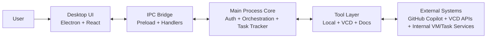

# Slide 2: Architecture & Design

## Architecture (One-Slide View)
- **Desktop Client (Electron + React):** Unified UI for chat, VMs, documents, and tasks.
- **Main Process Services:** Auth handling, tool orchestration, IPC handlers, and task tracking.
- **Tool Layer:** Local execution + VCD operations + document parsing/storage.
- **External Integrations:** GitHub Copilot, VCD APIs, and internal VM/task systems.

## High-Level Architecture Diagram

## Design Principles
- Clear separation between renderer UI, main process orchestration, and tool modules.
- Human-in-the-loop approvals for sensitive or risky operations.
- Extensible registry-based tool model for adding new capabilities safely.
