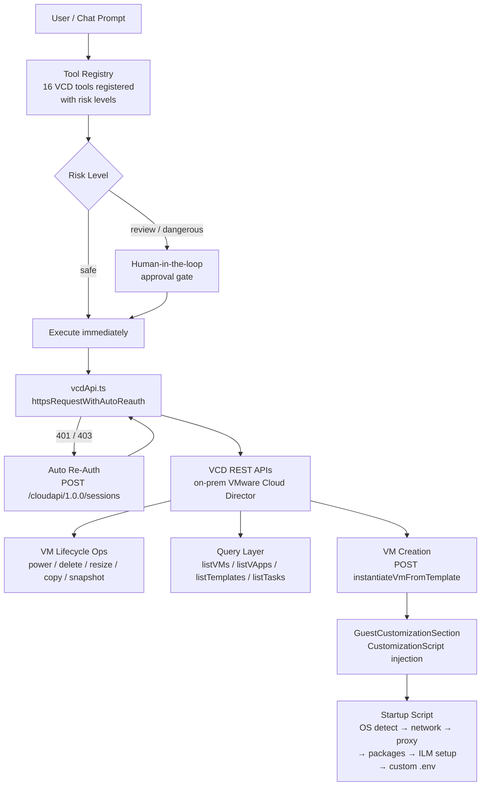

# Slide 2: Architecture & Design

## How We Integrate with VCD APIs

The core of Local Copilot is a custom VCD integration layer that translates natural-language requests into VMware Cloud Director REST API calls.

**Authentication (`vcdAuth.ts`)**
- Authenticates via `POST /cloudapi/1.0.0/sessions` and extracts a Bearer token from the `x-vmware-vcloud-access-token` response header.
- Session (token + org UUID + VDC context) is encrypted at rest using OS-level secure storage.
- **Auto-reauth**: any 401/403 from any VCD call silently triggers a re-login with stored credentials and retries the original request — no manual intervention needed.

**VCD API Calls (`vcdApi.ts`)**
- All calls go through `httpsRequestWithAutoReauth`, which wraps Node's native `https` module, injects `Authorization`, `x-vmware-vcloud-tenant-context`, and `x-vmware-vcloud-auth-context` headers, and handles timeout + error logging.
- VM records are fetched via `GET /api/query?type=vm` using server-side filters (`ownerName`, `isVAppTemplate==false`).
- vApps, templates, tasks, and snapshots each have dedicated query endpoints.
- Power operations, resize, snapshot, copy, and delete use standard VCD REST action URLs.

## Custom VCD Tool Registry (16 tools)

Tools are registered via a `toolRegistry.register()` factory in `tools/categories/vcd/index.ts`. Each tool declares its name, description, input schema (Zod), risk level (`safe` / `review` / `dangerous`), and the underlying `vcdApi.ts` function it delegates to.

| Tool | VCD API endpoint | Risk |
|---|---|---|
| `vcd:listVms` | `GET /api/query?type=vm` | safe |
| `vcd:listVapps` | `GET /api/query?type=vApp` | safe |
| `vcd:listTemplates` | `GET /api/query?type=vAppTemplate` | safe |
| `vcd:getVmDetails` | `GET /api/vApp/vm-{id}` | safe |
| `vcd:checkVmStatus` | derived from listVms | safe |
| `vcd:listTasks` | `GET /api/query?type=task` | safe |
| `vcd:powerOnVm` | `POST /power/action/powerOn` | review |
| `vcd:powerOffVm` | `POST /power/action/powerOff` | dangerous |
| `vcd:deleteVm` | `DELETE /api/vApp/vm-{id}` | dangerous |
| `vcd:createSnapshot` | `POST /cloudapi/1.0.0/vm/{urn}/snapshots` | review |
| `vcd:revertSnapshot` | `POST /action/revertToCurrentSnapshot` | dangerous |
| `vcd:listSnapshots` | `GET /api/query?type=snapshot` | safe |
| `vcd:copyVm` | `POST /action/recomposeVApp` | review |
| `vcd:resizeVm` | `PUT /virtualHardwareSection/cpu or memory` | review |
| `vcd:allocateFreeIp` | internal IP pool query | review |
| `vcd:getContext` / `vcd:setContext` | local session context | safe / review |

`review`-level tools require human-in-the-loop approval before execution. `dangerous` tools require explicit confirmation.

## VM Creation & Startup Script Injection

When a new VM is created from a template, a multi-stage bash script is assembled at runtime and injected directly into the VCD `GuestCustomizationSection` of the `InstantiateVmTemplateParams` XML payload (`POST /api/vdc/{vdcId}/action/instantiateVmFromTemplate`).

**Script composition (assembled in `getUnifiedCustomizationScript()`):**
1. **OS Detection** — identifies SLES, Ubuntu, or RHEL at boot time.
2. **Network Configuration** — writes static IP, gateway, and DNS via `networkSetup` scripts (per-OS: netplan for Ubuntu, wicked for SLES, nmcli for RHEL). IP and gateway are substituted from form inputs at script-build time.
3. **Proxy Cleanup** — removes any inherited proxy settings (`proxyCleanup` script).
4. **Package Installation** — installs Docker and required packages on Ubuntu (`packageInstall` script).
5. **ILM Setup** — downloads and launches the ILM compose stack from the internal Jenkins artefact store, if `setup_ilm=true` (`ilmSetup` script).
6. **Custom `.env` Injection** — if a `.env` file is provided, LLM-assisted URL rewriting updates all ILM service endpoints to the new VM IP before embedding it in the script as a heredoc.
7. **Finalization** — ensures network restart and logs completion (`finalization` script).

The assembled script is embedded as `<CustomizationScript><![CDATA[...]]></CustomizationScript>` inside the XML payload. VCD executes it on first boot during the post-customization phase.

## High-Level Architecture Diagram

## Design Principles
- All VCD operations route through a single authenticated HTTP layer with built-in auto-reauth and request logging.
- The tool registry enforces risk-level governance — no dangerous operation executes without human approval.
- Startup script composition is modular: each concern (network, proxy, packages, ILM) is a separate script fragment injected at VM-creation time.
- Custom `.env` content is rewritten with the new VM IP (LLM-assisted, with a deterministic fallback) before being embedded in the script.
